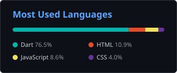

  

  

  
  

## About me

I'm a Flutter developer and vibe engineer from Egypt. I build mobile apps, websites and ERP systems, and I design the interfaces too, from Figma screens to complete design systems. I like shipping products end to end, in Arabic and English.

- 📱 Building Flutter apps for Android and iOS
- 🛍️ Building Rovelio, a bilingual clothing store (Next.js + Supabase)
- 🏢 Working on ERP systems for real businesses
- 🎨 Designing in Figma and building design systems
- ⚡ Vibe engineering: shipping faster with AI tools like Claude Code
- 🎮 Some knowledge of Unreal Engine 5, and familiar with how it works

## Tech stack

  
  
  
  
  
  
  
  
  
  
  
  
  
  

## Featured projects

<table>
  <tr>
    <td width="50%" valign="top">
      <b>Rovelio</b> &nbsp;🔒 Private 
      Bilingual (Arabic/English) clothing store for Egypt: storefront and admin panel. 
      <code>Next.js</code> <code>Supabase</code> <code>TypeScript</code>
    </td>
    <td width="50%" valign="top">
      <b>Daftar · دفتر</b> &nbsp;🔒 Private 
      The partners' notebook: a Flutter app to record expenses, income and settlements. 
      <code>Flutter</code> <code>Dart</code>
    </td>
  </tr>
  <tr>
    <td width="50%" valign="top">
      <b>Al-Karnak · الكرنك</b> &nbsp;🔒 Private 
      Handmade Egyptian pottery store with an Arabic + English storefront and admin. 
      <code>Next.js</code> <code>TypeScript</code>
    </td>
    <td width="50%" valign="top">
      <b>Socialyst</b> &nbsp;🔒 Private 
      Personal social media posting app, built on open-source Postiz. 
      <code>TypeScript</code>
    </td>
  </tr>
  <tr>
    <td width="50%" valign="top">
      <a href="https://github.com/AhmedEmamMM/E-Commerce-UI-App"><b>Tokoto</b></a> 
      E-commerce app UI in Flutter: onboarding, sign-in and sign-up with OTP, and a product home screen. Feature-first structure. 
      <code>Flutter</code> <code>Dart</code> <code>Provider</code>
    </td>
    <td width="50%" valign="top">
      <a href="https://github.com/AhmedEmamMM/playbooks"><b>Playbooks</b></a> 
      My personal library of steps and prompts, opened from a single HTML file. 
      <code>JavaScript</code> <code>CSS</code>
    </td>
  </tr>
</table>

## GitHub stats

  
  

  

  <picture>
    <source media="(prefers-color-scheme: dark)" srcset="https://raw.githubusercontent.com/AhmedEmamMM/AhmedEmamMM/output/github-snake-dark.svg" />
    
  </picture>

## Get in touch

  
  

